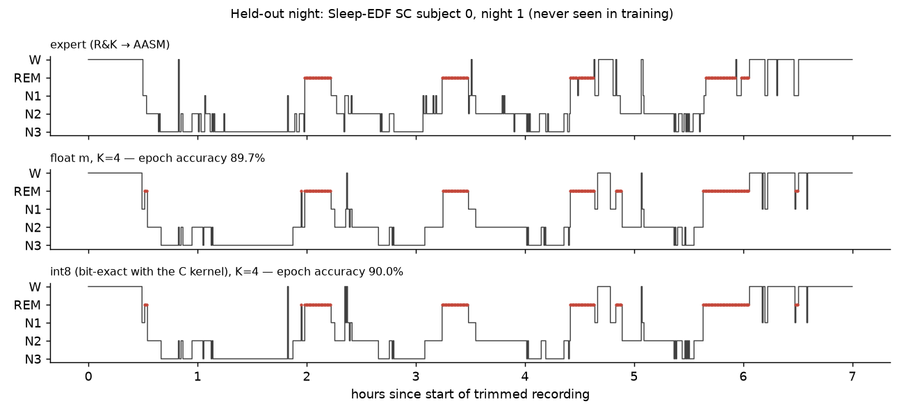
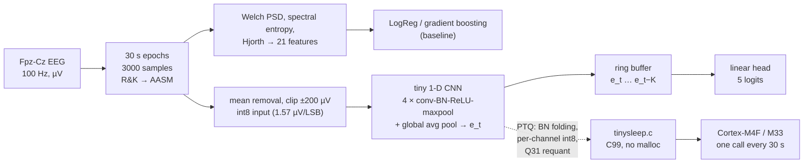
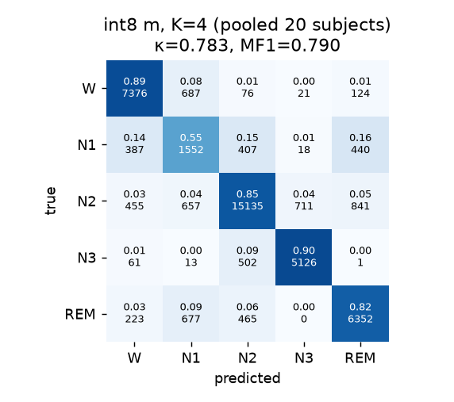
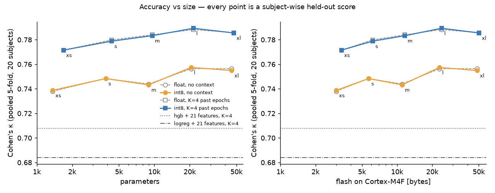
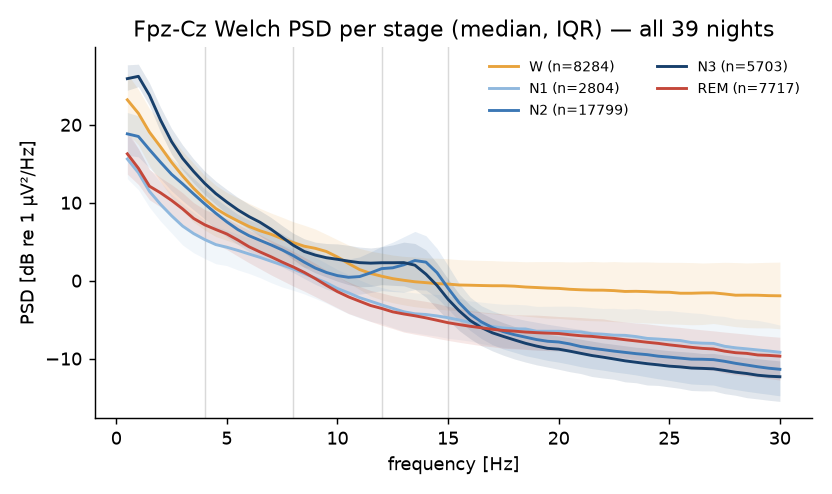

# hypnogram-on-a-chip: sleep staging from one EEG channel in a few KiB of int8



A 1-D CNN with 1.7k to 47k parameters scores 30 s epochs of single-channel Fpz-Cz EEG into W, N1, N2, N3 and REM, quantised to int8 and run by a 116-line C99 kernel that matches its Python reference bit for bit. On 20 Sleep-EDF subjects with subject-wise 5-fold cross-validation, a 9.6k-parameter model (11.4 KiB flash on a Cortex-M4F) reaches Cohen's κ 0.783 and accuracy 0.840. Going from 1.7k to 21k parameters adds only 0.017 κ; two minutes of causal context adds 0.04.

<!-- TODO(Tommaso): your own words on why -->

| | params | flash (Cortex-M4F) | RAM | accuracy | macro-F1 | Cohen's κ |
|---|---|---|---|---|---|---|
| gradient boosting, 21 hand-crafted features, 4 past epochs | - | - | - | 0.783 | 0.727 | 0.708 |
| CNN-xs, int8, 4 past epochs | 1 685 | 3.3 KiB | 6.0 KiB | 0.831 | 0.776 | 0.772 |
| CNN-m, int8, 4 past epochs | 9 589 | 11.4 KiB | 6.0 KiB | 0.840 | 0.790 | 0.783 |
| CNN-l, int8, 4 past epochs | 21 549 | 23.4 KiB | 12.0 KiB | 0.844 | 0.795 | 0.789 |

* int8 predictions agree with the float model on 98.2–99.0 % of the 42 307 held-out epochs, with no κ loss (|Δκ| ≤ 0.001).
* The C kernel, compiled with the host `cc` and fed raw float µV, gives int8 logits identical to the NumPy reference on all 8 154 fold-0 test epochs, for all 10 models.
* Flash and RAM are `arm-none-eabi-size` of kernel + weights for `-mcpu=cortex-m4 -mfloat-abi=hard -Os`, not measured on a board. Latency is an estimate, see below.

## Pipeline



## Data and protocol

* **Dataset.** Sleep-EDF Expanded, sleep-cassette study (Kemp et al., 2000; PhysioNet, Goldberger et al., 2000), loaded with `mne.datasets.sleep_physionet.age.fetch_data`. Subjects 0-19 (the "Sleep-EDF-20" subset used by most single-channel papers). Subject 13 has only one night, hence 39 nights. `scripts/download.py` pulls the files from PhysioNet's AWS open-data mirror (the main site is often throttled to ~50 kB/s) and checks every file against the SHA-1 list that ships with MNE before handing over to `fetch_data`.
* **Labels.** R&K stages 3 and 4 → AASM N3; "Movement time" and "?" epochs dropped; wake trimmed to 30 min before the first and after the last sleep epoch. Without trimming, ~70 % of each 20 h recording is wake and any classifier looks great.
* **Class counts after preprocessing:** W 8 284 · N1 2 804 · N2 17 799 · N3 5 703 · REM 7 717 (total 42 307).
* **Split: subject-wise 5-fold CV.** Fold *f* tests on 4 subjects (both nights), uses 2 other subjects for early stopping, trains on the remaining 14. Every subject is tested exactly once; predictions of the 5 folds are pooled and scored together.

### Why subject-wise and not epoch-wise

Two adjacent 30 s epochs of the same night are almost the same signal: same electrode impedance, same amplitude scale, same alpha frequency, same artefacts. If epochs are shuffled into train/test, the model is tested on near-copies of its training data and learns *who* is sleeping as much as *how*. Nights of the same person share this too, so both nights of a subject always live in the same fold (`tests/test_data.py::test_subject_wise_split_has_no_leakage`). The number we report is the one that matters for a device: accuracy on a person the model has never seen.

## Methods

### Classical baseline, 21 features per epoch

**Welch PSD.** Each epoch $x[n]$, $n=0..N-1$, is cut into $M$ Hann-windowed segments of $L = 200$ samples (2 s) with 50 % overlap:

$$
\hat P(f_k) = \frac{1}{M}\sum_{m=0}^{M-1} \frac{1}{f_s \sum_n w[n]^2}\,\Bigl|\sum_{n=0}^{L-1} w[n]\,x[n+mD]\,e^{-j2\pi kn/L}\Bigr|^2,\qquad D = L/2
$$

giving 0.5 Hz resolution. Band power $P_b = \sum_{f_k\in b}\hat P(f_k)\,\Delta f$ for δ 0.5–4, θ 4–8, α 8–12, σ 12–15, β 15–30 Hz; we use $\log_{10} P_b$ and relative power $P_b/P_{0.5-30}$.

**Spectral entropy** of the normalised spectrum $p_k = \hat P(f_k)/\sum_j \hat P(f_j)$ over the $K$ bins in 0.5–30 Hz:

$$
H_s = -\frac{1}{\log_2 K}\sum_k p_k \log_2 p_k \in [0, 1]
$$

(≈ 0 for a pure tone, ≈ 1 for white noise; tested in `tests/test_features.py`).

**Hjorth parameters** (Hjorth, 1970), with $x'$ the first difference:

$$
\mathrm{Activity} = \sigma_x^2,\qquad
\mathrm{Mobility} = \sqrt{\frac{\sigma_{x'}^2}{\sigma_x^2}},\qquad
\mathrm{Complexity} = \frac{\mathrm{Mobility}(x')}{\mathrm{Mobility}(x)}
$$

For a sampled sine of frequency $f$, $\mathrm{Mobility} = 2\sin(\pi f/f_s)$ exactly, that identity is a unit test.

Plus θ/α, δ/β, σ/θ, α/δ log-ratios, log peak-to-peak and zero-crossing rate. Classifiers: L2 logistic regression (class-balanced) and histogram gradient boosting (300 trees). With context, the feature vectors of the previous $K=4$ epochs are concatenated (causal, same as the CNN).

### Tiny CNN

Each block is $\mathrm{Conv1d}(k, s) \rightarrow \mathrm{BN} \rightarrow \mathrm{ReLU} \rightarrow \mathrm{MaxPool}(p)$; four blocks with $(k, s, p) = (15,2,4), (7,1,4), (5,1,4), (5,1,2)$ and the widths below, then global average pooling to a $D$-dim epoch embedding $e_t$, then one linear layer.

| name | channels | D | params (K=0 / K=4) | MACs per epoch |
|---|---|---|---|---|
| xs | 4-8-8-16 | 16 | 1,365 / 1,685 | 0.22 M |
| s | 8-12-16-24 | 24 | 3,857 / 4,337 | 0.57 M |
| m | 8-16-32-32 | 32 | 8,949 / 9,589 | 0.87 M |
| l | 16-24-48-48 | 48 | 20,589 / 21,549 | 2.17 M |
| xl | 16-32-64-96 | 96 | 45,477 / 47,397 | 3.36 M |

Parameters are counted after BN folding (one bias per channel), i.e. exactly what ends up in flash.

**Receptive field.** With jump $j_0 = 1$, $r_0 = 1$, every conv or pool layer $\ell$ of kernel $k_\ell$ and stride $s_\ell$ updates

$$
r_\ell = r_{\ell-1} + (k_\ell - 1)\,j_{\ell-1},\qquad j_\ell = j_{\ell-1}\,s_\ell
$$

which gives $r = 957$ samples = 9.6 s for every width (only channels change). The global average pool then integrates the whole 30 s epoch: each output unit sees ~10 s windows, the classifier sees their average, which is the right inductive bias for spindles (0.5–2 s), K-complexes (~1 s) and slow waves (>0.5 s) that can occur anywhere in the epoch.

**Sequence context, causal.** Scorers look at neighbouring epochs (N1/REM are defined partly by what came before). The head sees $[e_t, e_{t-1}, \dots, e_{t-K}]$, so on the MCU we only store $K \cdot D$ bytes of past embeddings, not past raw signal, and the model can run on-line. Missing history at the start of the night is filled with $e_0$, identically in PyTorch, NumPy and C. Training: stage 1 trains encoder + context-free head end-to-end (AdamW, one-cycle LR, 20 epochs, class weights $\propto 1/\sqrt{\text{freq}}$, random gain 0.8–1.25 and white noise as augmentation, early stopping on validation κ); stage 2 freezes the encoder and fits the linear context head for $K \in \{0, 2, 4, 8\}$.

### int8 post-training quantisation, and the C kernel

Affine quantisation maps a real tensor to 8-bit codes with a scale $s$ and zero point $z$ (Jacob et al., 2018):

$$
q = \mathrm{clamp}\!\left(\mathrm{round}\!\left(\frac{x}{s}\right) + z,\ -128,\ 127\right),\qquad x \approx s\,(q - z)
$$

* BatchNorm is folded into the preceding conv: $W' = W\,\gamma/\sqrt{\sigma^2+\epsilon}$, $b' = \beta - \mu\,\gamma/\sqrt{\sigma^2+\epsilon}$.
* Weights: symmetric ($z=0$), one scale per output channel, $s_w[c] = \max|W'_c|/127$. Biases: int32 with scale $s_\text{in}s_w[c]$.
* Activations: one $(s, z)$ per tensor from the 99.99th percentile on 2 000 *training-subject* epochs; post-ReLU tensors use $z=-128$ so $[0, a_\max]$ spans all 256 codes, and ReLU becomes a clamp at $z$.
* A conv output is an int32 accumulator, rescaled with an integer-only multiplier:

$$
\mathrm{acc}_c = b_c + \sum_{i,k} W_{c,i,k}\,(q_{i,t+k} - z_\text{in}),\qquad
q_\text{out} = \Bigl\lfloor \frac{\mathrm{acc}_c\,M_0[c] + 2^{n_c-1}}{2^{n_c}} \Bigr\rfloor + z_\text{out},\qquad
\frac{s_\text{in}s_w[c]}{s_\text{out}} = M_0[c]\,2^{-n_c},\ M_0 \in [2^{30}, 2^{31})
$$

* Global average pooling uses the same trick with $M = s_a/(L\,s_e)$; the head produces int8 logits; prediction = argmax.

`c/tinysleep.c` (116 lines, C99, no malloc, no libm in the integer path) implements exactly that, with conv + requant + ReLU + maxpool fused so the un-pooled map is never stored. `tinysleep/quant.py` contains a NumPy implementation of the *same* integer arithmetic. The C build uses `-ffp-contract=off` so the one floating-point step (input mean removal and scaling) rounds identically in both.

## Results

All numbers are pooled over the 5 test folds (20 subjects, 39 nights, 42 307 epochs); no number below was tuned on the subjects it is reported on.

| model | acc | MF1 | κ | F1 W | F1 N1 | F1 N2 | F1 N3 | F1 REM |
|---|---|---|---|---|---|---|---|---|
| LogReg, 21 features | 0.734 | 0.676 | 0.647 | 0.73 | 0.33 | 0.83 | 0.84 | 0.64 |
| Gradient boosting, 21 features | 0.749 | 0.687 | 0.664 | 0.80 | 0.30 | 0.83 | 0.86 | 0.64 |
| LogReg, 21 features × (t … t−4) | 0.762 | 0.712 | 0.684 | 0.77 | 0.40 | 0.84 | 0.87 | 0.68 |
| Gradient boosting, 21 features × (t … t−4) | 0.783 | 0.727 | 0.708 | 0.82 | 0.39 | 0.85 | 0.88 | 0.70 |
| CNN-xs, K=0, float | 0.807 | 0.729 | 0.738 | 0.87 | 0.29 | 0.87 | 0.87 | 0.75 |
| CNN-xs, K=0, int8 | 0.808 | 0.732 | 0.739 | 0.87 | 0.30 | 0.87 | 0.87 | 0.75 |
| CNN-xs, K=4, float | 0.831 | 0.775 | 0.771 | 0.90 | 0.42 | 0.87 | 0.88 | 0.80 |
| CNN-xs, K=4, int8 | 0.831 | 0.776 | 0.772 | 0.90 | 0.43 | 0.87 | 0.88 | 0.80 |
| CNN-s, K=0, float | 0.815 | 0.741 | 0.748 | 0.87 | 0.33 | 0.87 | 0.88 | 0.76 |
| CNN-s, K=0, int8 | 0.815 | 0.742 | 0.748 | 0.86 | 0.34 | 0.87 | 0.88 | 0.76 |
| CNN-s, K=4, float | 0.837 | 0.785 | 0.780 | 0.89 | 0.46 | 0.88 | 0.88 | 0.82 |
| CNN-s, K=4, int8 | 0.837 | 0.784 | 0.779 | 0.88 | 0.45 | 0.88 | 0.88 | 0.82 |
| CNN-m, K=0, float | 0.812 | 0.736 | 0.744 | 0.86 | 0.32 | 0.87 | 0.87 | 0.75 |
| CNN-m, K=0, int8 | 0.811 | 0.736 | 0.743 | 0.86 | 0.32 | 0.87 | 0.88 | 0.75 |
| CNN-m, K=4, float | 0.841 | 0.791 | 0.784 | 0.88 | 0.49 | 0.88 | 0.88 | 0.82 |
| CNN-m, K=4, int8 | 0.840 | 0.790 | 0.783 | 0.88 | 0.49 | 0.88 | 0.89 | 0.82 |
| CNN-l, K=0, float | 0.820 | 0.756 | 0.756 | 0.87 | 0.38 | 0.87 | 0.88 | 0.78 |
| CNN-l, K=0, int8 | 0.821 | 0.758 | 0.757 | 0.87 | 0.39 | 0.87 | 0.88 | 0.78 |
| CNN-l, K=4, float | 0.844 | 0.793 | 0.788 | 0.88 | 0.49 | 0.88 | 0.89 | 0.84 |
| CNN-l, K=4, int8 | 0.844 | 0.795 | 0.789 | 0.88 | 0.49 | 0.88 | 0.89 | 0.84 |
| CNN-xl, K=0, float | 0.820 | 0.758 | 0.756 | 0.87 | 0.39 | 0.87 | 0.89 | 0.77 |
| CNN-xl, K=0, int8 | 0.819 | 0.758 | 0.755 | 0.87 | 0.40 | 0.87 | 0.89 | 0.77 |
| CNN-xl, K=4, float | 0.842 | 0.793 | 0.786 | 0.88 | 0.49 | 0.88 | 0.89 | 0.83 |
| CNN-xl, K=4, int8 | 0.842 | 0.793 | 0.786 | 0.88 | 0.49 | 0.88 | 0.89 | 0.83 |

int8 rows are the bit-exact NumPy reference of the C kernel over all 5 folds (the C binary itself was run on fold 0, see below).

What the per-class columns say: with 4 past epochs, W, N2, N3 and REM are at 0.80–0.90 F1 for every CNN size; N1 is the stage that separates models (0.29 → 0.49) and the one that context helps most (+0.13 F1 for xs). In the confusion matrix below, N1 leaks to W, N2 and REM in roughly equal parts, it *is* a transition stage, and on a frontal channel without EOG/EMG REM looks like N1 (see the PSD figure).



### Accuracy vs size

| model | K | params | MACs/epoch | flash M4F | flash M33 | RAM | κ float | κ int8 | int8=float | C=NumPy | est. ms @64 / 128 MHz (ref kernel) |
|---|---|---|---|---|---|---|---|---|---|---|---|
| xs | 0 | 1,365 | 0.22 M | 2.9 KiB | 2.9 KiB | 5.9 KiB | 0.738 | 0.739 | 98.2 % | 100.0 % | 55 / 27 |
| s | 0 | 3,857 | 0.57 M | 5.6 KiB | 5.6 KiB | 5.9 KiB | 0.748 | 0.748 | 98.7 % | 100.0 % | 141 / 71 |
| m | 0 | 8,949 | 0.87 M | 10.8 KiB | 10.8 KiB | 5.9 KiB | 0.744 | 0.743 | 98.6 % | 100.0 % | 218 / 109 |
| l | 0 | 20,589 | 2.17 M | 22.5 KiB | 22.5 KiB | 11.8 KiB | 0.756 | 0.757 | 98.6 % | 100.0 % | 542 / 271 |
| xl | 0 | 45,477 | 3.36 M | 47.4 KiB | 47.4 KiB | 11.8 KiB | 0.756 | 0.755 | 98.6 % | 100.0 % | 841 / 421 |
| xs | 4 | 1,685 | 0.22 M | 3.3 KiB | 3.3 KiB | 6.0 KiB | 0.771 | 0.772 | 98.5 % | 100.0 % | 55 / 27 |
| s | 4 | 4,337 | 0.57 M | 6.0 KiB | 6.0 KiB | 6.0 KiB | 0.780 | 0.779 | 99.0 % | 100.0 % | 142 / 71 |
| m | 4 | 9,589 | 0.87 M | 11.4 KiB | 11.4 KiB | 6.0 KiB | 0.784 | 0.783 | 98.7 % | 100.0 % | 218 / 109 |
| l | 4 | 21,549 | 2.17 M | 23.4 KiB | 23.4 KiB | 12.0 KiB | 0.788 | 0.789 | 98.9 % | 100.0 % | 543 / 271 |
| xl | 4 | 47,397 | 3.37 M | 49.2 KiB | 49.2 KiB | 12.2 KiB | 0.786 | 0.786 | 98.8 % | 100.0 % | 842 / 421 |



Context ablation (float, pooled κ), the linear head over $[e_t, \dots, e_{t-K}]$:

| | K=0 | K=2 | K=4 | K=8 |
|---|---|---|---|---|
| xs | 0.738 | 0.767 | 0.771 | 0.778 |
| s | 0.748 | 0.778 | 0.780 | 0.786 |
| m | 0.744 | 0.783 | 0.784 | 0.787 |
| l | 0.756 | 0.787 | 0.788 | 0.790 |
| xl | 0.756 | 0.785 | 0.786 | 0.784 |

**How much of this is noise.** Resampling the 20 subjects with replacement (2 000 bootstrap draws) gives 95 % intervals about ±0.04 wide for every model (e.g. CNN-m K=4: [0.741, 0.820]); the subject you happen to test on matters more than the architecture. Paired over the same resamples: K=4 vs K=0 for CNN-m is +0.040 [0.026, 0.053], clearly real; CNN-l vs CNN-xs (both K=4) is +0.017 [0.001, 0.030], barely distinguishable from zero. xl is not better than l. The reading of the Pareto front: the knee is at a few thousand parameters; past ~5 k, capacity is not what limits a single frontal channel. (`scripts/tables.py` prints all of it.)

### int8 vs float, and C vs Python

Per-tensor activation scales + per-channel weight scales are enough here: PTQ costs nothing measurable (κ changes by −0.001 … +0.001), while 1–2 % of individual epochs flip class in both directions. No quantisation-aware training was needed.

The C check runs `c/main.c` on a binary dump of the 8 nights of fold 0's test subjects (8 154 epochs, raw float µV), with the model exported by `export_c_header`. For all 10 models (5 sizes × K ∈ {0, 4}) the int8 logits from C equal the NumPy reference in 100.000 % of epochs, and C predictions agree with the float PyTorch model on 98.4–99.3 % of them. `tests/test_quant.py::test_c_kernel_is_bit_exact` repeats this on synthetic EEG in CI, including the ring-buffer reset between nights.

### Footprint and latency on a Cortex-M4F / M33

**Measured with the compiler** (`arm-none-eabi-gcc 15.2`, `-Os`, kernel + weights + exactly-sized static buffers, no startup/HAL): see the flash/RAM columns above. RAM is two ping-pong activation buffers (the int8 input epoch, 3 000 B, is the largest tensor up to *m*) + $(K+1)\,D$ bytes of embedding history. Weights dominate flash from *s* upwards; kernel code + layer tables are 1 322 B for every model.

**Latency, estimated rather than measured.** Assumptions, stated so they can be checked:

* MACs per epoch from the layer shapes (table above); everything else (requantisation, pooling, input scaling) is < 5 % of that.
* The reference kernel's inner loop compiles (`-O2`, Cortex-M4) to 13 instructions per MAC: two `LDRSB`, a zero-point subtraction, `MLA`, plus a padding bounds check and loop overhead. At ≈ 1.2 cycles per instruction that is ≈ 16 cycles/MAC, which gives the "est. ms" column: 27 ms (xs) to 0.42 s (xl) per 30 s epoch at 128 MHz, i.e. a duty cycle of 0.1–1.4 %.
* A CMSIS-NN-style kernel (pre-padded input, `SMLAD` doing two 16-bit MACs per cycle, unrolled loops) should get to roughly 1–2 cycles/MAC, i.e. another ~8–16×, an expectation, not something I have measured.
* The Cortex-M33 (e.g. nRF54L15 at 128 MHz) has the same DSP extension; the `-mcpu=cortex-m33` build has byte-identical flash/RAM to the M4F one for all 10 models.

Either way, the network is not the bottleneck: the MCU spends > 98 % of each epoch asleep, and the AFE and radio will dominate the energy budget.

### Comparison with the literature (read as trend, not as a leaderboard)

On the same 20 subjects and the same channel, DeepSleepNet (Supratak et al., 2017) reports 82.0 % accuracy and 76.9 macro-F1 (abstract of the paper, 20-fold CV, Fpz-Cz). It uses a two-branch CNN plus a *bidirectional* LSTM over the whole sequence, so it sees future epochs and is not causal. TinySleepNet (Supratak & Guo, 2020) reports higher numbers with a much smaller model than DeepSleepNet; I did not verify its exact figures, so I don't quote them.

What can be said honestly:

* our numbers are in the same band as those published single-channel models, with 2–4 orders of magnitude fewer parameters and causal context only;
* but folds, wake trimming, the R&K → AASM mapping, the number of CV folds and whether metrics are pooled or averaged all differ between papers, and each moves κ by a few hundredths, about the size of the differences between our own models. This table is a sanity check that nothing is badly broken, not a ranking.

### What the spectrum says



The textbook picture comes out of the raw data without any model: N3 has the most δ power (~7 dB above N2 at 1 Hz), N2 and N3 show the σ bump at 12–15 Hz (spindles), wake dominates everything above 15 Hz (on a forehead channel that is as much muscle and eye-movement artefact as cortical β, and there is little α at Fpz-Cz), and REM and N1 sit almost on top of each other, exactly the pair every model confuses.

## Limitations

* **20 healthy subjects aged 25–34 (10 F, 10 M), one lab, one recording system.** Nothing here says anything about older people, patients (apnea, insomnia, narcolepsy), medication, or a different electrode montage. A dry-electrode headband will have a different noise floor, impedance and artefact profile than the clinical PSG electrodes used here.
* **One scorer, R&K rules.** Labels are a single expert's R&K hypnogram mapped to AASM; inter-scorer agreement on the full five classes is itself well below 1, and N1 is the least reliable stage for humans too. Our N1 F1 (~0.4–0.5) is the weakest number and should be read that way.
* **No hyper-parameter search across folds**, one seed per fold. Differences of ≤ 0.01 κ between models are inside the subject-bootstrap noise (±0.04).
* **Validation subjects** for early stopping come from the next fold's test block, so they are disjoint from the training *and* the test subjects of that fold, but the architecture choices (layer shapes, 20 epochs, clip at ±200 µV) were made by me while looking at early results on fold 0. Mild optimistic bias is possible.
* **Footprint numbers are compiler measurements, not device measurements.** Flash/RAM come from `arm-none-eabi-size` on the kernel + model objects (no startup code, no HAL, no BLE stack). Latency is a static estimate (below), never run on silicon.
* **The raw epoch buffer is not counted** in the model RAM: 3000 samples must be stored somewhere before the per-epoch mean is known (6 KiB as int16, 12 KiB as float). A streaming high-pass filter instead of per-epoch mean removal would remove that requirement; not done here.
* **PTQ only**, no quantisation-aware training; it was not needed (≤ 0.001 κ loss) but the margin may be smaller on other data.

## Reproduce

```bash
python3.12 -m venv .venv && source .venv/bin/activate
pip install -e ".[data,dev]"
python scripts/download.py --subjects 0-19   # ~2 GB, SHA-1 verified
python scripts/prepare.py                    # -> data/cache/*.npz (39 nights)
python scripts/baseline.py                   # -> results/baseline.json
python scripts/train_cnn.py                  # -> models/, results/cnn.json (MPS/CUDA/CPU)
python scripts/quantize_eval.py              # -> results/quant.json, build/ (cc + arm-none-eabi-gcc)
python scripts/figures.py                    # -> figures/*.png
pytest -q                                    # synthetic data only, includes C == NumPy bit-exactness
```

Wall-clock on a 16-core Apple-silicon laptop: download ~3 min from the S3 mirror, prepare 30 s, baselines ~10 min (gradient boosting with 105 context features is the slow part; sklearn's OpenMP pool stalls on macOS so the script pins `OMP_NUM_THREADS=1`), CNN training ~3 h for all 5 sizes × 5 folds on the GPU (MPS), quantisation + C check ~15 min. Every number in this README is in `results/*.json` and is regenerated by `scripts/tables.py`.

## Layout

```
tinysleep/   data.py (epochs, labels, folds) · features.py · models.py · quant.py (PTQ + int8 reference + C export) · metrics.py
c/           tinysleep.{h,c} (kernel) · main.c (host harness) · mcu_entry.c (footprint probe) · models/ (K=4 headers of the fold-0 models, trained on 14 subjects)
scripts/     download · prepare · baseline · train_cnn · quantize_eval · figures
results/     *.json with every number in this README
```

## References

* B. Kemp, A. H. Zwinderman, B. Tuk, H. A. C. Kamphuisen, J. J. L. Oberye. *Analysis of a sleep-dependent neuronal feedback loop: the slow-wave microcontinuity of the EEG.* IEEE TBME 47(9), 2000. [doi:10.1109/10.867928](https://doi.org/10.1109/10.867928)
* A. L. Goldberger et al. *PhysioBank, PhysioToolkit, and PhysioNet.* Circulation 101(23), 2000. [doi:10.1161/01.CIR.101.23.e215](https://doi.org/10.1161/01.CIR.101.23.e215)
* A. Supratak, H. Dong, C. Wu, Y. Guo. *DeepSleepNet: a model for automatic sleep stage scoring based on raw single-channel EEG.* IEEE TNSRE 25(11), 2017. [doi:10.1109/TNSRE.2017.2721116](https://doi.org/10.1109/TNSRE.2017.2721116)
* A. Supratak, Y. Guo. *TinySleepNet: an efficient deep learning model for sleep stage scoring based on raw single-channel EEG.* EMBC 2020. [doi:10.1109/EMBC44109.2020.9176741](https://doi.org/10.1109/EMBC44109.2020.9176741)
* B. Jacob et al. *Quantization and training of neural networks for efficient integer-arithmetic-only inference.* CVPR 2018. [doi:10.1109/CVPR.2018.00286](https://doi.org/10.1109/CVPR.2018.00286)
* B. Hjorth. *EEG analysis based on time domain properties.* Electroencephalogr. Clin. Neurophysiol. 29(3), 1970. [doi:10.1016/0013-4694(70)90143-4](https://doi.org/10.1016/0013-4694(70)90143-4)

All DOIs resolved on Crossref on 2026-10-30.

## License

MIT © 2026 Tommaso Maggiolo. The Sleep-EDF data are not redistributed here; they are available from PhysioNet under the Open Data Commons Attribution License v1.0.
